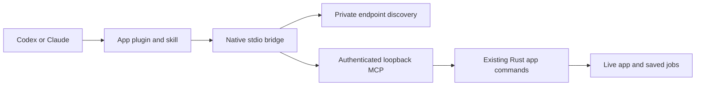

# Whirlwind native MCP contract

VectorEffects, Hindsight Sync, Hindsight Router and PolarExplorer use this versioned Rust kit for local assistant connections. Each app keeps its own domain tools and live application state. Connecting from **Settings → AI assistants** installs the app's plugin and applies the selected permission policy in one operation.

## Runtime contract

- `--mcp` runs before GUI initialization. `initialize` and `tools/list` use the compiled catalog without launching the app. The first domain call opens the installed app if needed.
- Each app owns a lock and a version-1 `mcp/endpoint.json` containing port, process ID and bearer token. Unix directories are private and the endpoint file is owner-readable only. Disabling access closes the listener and removes discovery; another process cannot replace an owner's endpoint.
- The HTTP boundary binds only loopback, requires authentication, rejects browser origins and protects against host rebinding. The bridge disables proxy and redirect handling, rereads discovery on calls, and refreshes a rejected token once. It does not retry an ambiguous mutation failure.
- Native launchers inherit stdio and start the installed executable with arguments. Plugin configuration contains paths, never copied tokens. Packages need no Node, Python or shell runtime. The Python scripts here are developer checks only.
- `assistant_capabilities` describes the current inventory and contract. Every tool declares all four MCP effect hints and a `com.whirlwind/effect` category. Annotations describe behavior; explicit host permission rules control prompts.
- `assistant_jobs` exposes durable records or the app's existing durable job store. Long weather fetches, exports, routing batches and Hindsight Sync mutations remain independent of the requesting transport. Use explicit cancellation. `request_id` prevents duplicate submission on supported mutations; reuse it only for an identical request. App interruption is recorded rather than silently replayed. Domain progress tools remain authoritative for cloud workers and routing progress.
- Success payloads retain each app's established shape. Tool refusals include readable text and structured `error` fields (`code`, `message`, `retryable`), with `contract_version: 1`. Protocol validation still uses standard MCP errors. Credentials and assistant-control settings are removed from assistant-facing results.

## Permission policies

| Policy | Automatic work | Approval boundary |
| --- | --- | --- |
| Workflow, the default | Reads, reversible edits, views, configured-source downloads, saves and exports | Irreversible discard, new spending, unrestricted compatibility dispatch |
| Always ask | None requested by this installer | Host policy applies to every tool |
| Unrestricted | All tools supported by the host | Host-enforced approvals and app-side spending/quote rules still apply |

A normal project switch cannot discard unsaved work. Save first, or use the explicit `project_discard` tool after authorization. Advanced commands are inventoried and divided into `app_read`, `app_edit` and the compatibility fallback. Host installation, permissions, credentials and access controls are UI-only, including through fallback dispatchers.

Hindsight Sync returns a quote for every paid action, including recurring spending,
and for deletion. The assistant presents its scope and estimated costs in chat
and obtains the user's approval before calling `confirm_paid_action`. Settings
and host tool permissions never authorize spending. Estimates do not guarantee
a cloud provider's final bill.

## Installation and lifecycle

The shared local `~/.whirlwind/marketplace` contains four independent plugin directories and both marketplace formats. Codex receives `plugin.json`, `mcp.json` and a skill; Claude Code receives `.claude-plugin/plugin.json`, `.mcp.json` and the same skill. Claude Desktop receives a native `.mcpb` for the app's build platform, opened in its own extension installer. Desktop's installation and permission dialogs belong to the host.

Settings reports **Not connected**, **Restart required**, **Connected**, **Needs repair** or **Unavailable**. Connected requires a successful call from that host's native bridge to the current app endpoint. Test probes the local app only and does not claim to have verified a host. Repair refreshes the package, registration and owned permissions. Disconnect removes the app's host registration and owned permissions; Desktop removal is completed in its Extensions settings.

Installers serialize their own writers, back up edited configuration, detect concurrent changes, preserve unrelated settings and user permission overrides, and use bounded host CLI processes. Direct legacy registrations migrate only when their executable or exact local URL identifies the app. The old Hindsight Sync plugin migrates only from this app's resource directory; ambiguous or foreign same-name registrations remain untouched and report how to repair them. Installing another app preserves the other marketplace entries.

## App workflows

- **Hindsight Sync:** inspect and populate weather archives, create local copies and export GRIB. Approve quoted costs in chat before paid work starts.
- **VectorEffects:** import historical or recent weather, construct and edit fields, inspect results and export GRIB2 or Zarr. `export_start` returns a durable job immediately.
- **PolarExplorer:** import certificates, polars and tracks; fetch weather as a durable job; filter, edit and compare boats; export routing polars, including WhirlwindMatrixPolar.
- **Hindsight Router:** import course and polar, save a configuration, preview departures, run a durable batch, inspect routes and statistics, and export results. Dedicated tools cover these operations.

## Source ownership and checks

The canonical source is `HistorySyncer/crates/whirlwind-mcp`. The other repositories vendor this exact crate, with version and SHA-256 in `vendor/whirlwind-mcp.json`. Change the canonical crate, run its tests, then run `node tools/sync-mcp.mjs <VectorEffects> <WhirlwindPolarSolver> <HindsightRouter>` from HistorySyncer. Do not patch a vendor copy independently. `verify_snapshot.py` checks provenance before CI builds.

`cargo test -p whirlwind-mcp` covers transport rotation, private endpoints, configuration preservation, native packages, bounded processes, job replay/crash/cancellation. `native_contract.py <fixture> --hosts` exercises packages, stdio, installation, repair and removal using fresh temporary Codex and Claude profiles. `native_contract.py <app-binary> --app` checks a real app's native catalog without launching its GUI. No model call or cloud account is required.

Each repository's MCP contract workflow runs on macOS, Windows and Linux with pinned Codex and Claude Code CLIs. App tests separately verify tool/command inventory, UI-only boundaries, live-state behavior and translated connection controls. Real Desktop extension dialogs and model-driven host approval UX require release testing in those hosts. Public marketplace submission is a separate distribution step; these local plugins do not depend on publication.
